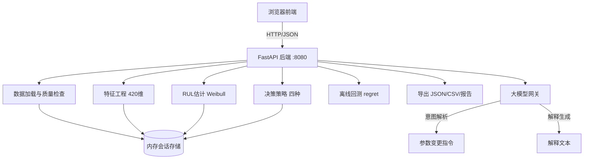

# PrognosOps 设计文档

> 版本:V1.0 | 日期:2026-10-22 | 状态:已确认
> 上位规约:PROJECT_RULES.md | 需求文档:docs/requirements.md

## 1. 技术架构

### 1.1 技术选型

| 层 | 技术 | 选型理由 |
|----|------|----------|
| 后端框架 | Python 3.10+ / FastAPI | 数值算法依赖 numpy/scipy;FastAPI 自带异步与 OpenAPI 文档 |
| 数值计算 | numpy、scipy.stats | Weibull MLE 拟合、离散概率、矩阵运算 |
| 大模型调用 | httpx(OpenAI 兼容接口) | 仅意图解析与解释生成,轻量依赖 |
| 前端 | 原生 HTML + CSS + JavaScript | 无构建步骤,兼容 JoyCode 浏览器直接预览 |
| 图表 | Chart.js(CDN 引入) | 轻量、无需构建、支持柱状图与折线图 |
| 部署 | Docker + JD DevCloud | Python 非平台原生语言,使用自定义 Dockerfile,端口 8080 |

### 1.2 系统架构图



### 1.3 核心模块职责

| 模块 | 文件 | 职责 |
|------|------|------|
| 数据加载 | app/core/data_loader.py | CSV 解析、FD001 格式校验、演示数据加载 |
| 质量检查 | app/core/quality.py | 数据质量检查与报告生成 |
| 特征工程 | app/core/features.py | 420 维特征提取与标准化 |
| RUL 估计 | app/core/rul.py | kNN 检索 + Weibull MLE 拟合 + 离散化 |
| 决策策略 | app/core/decision.py | ETO-C/IEO-C/ETO-Q/IEO-Q 计算与窗口选择 |
| 回测 | app/core/backtest.py | 离线回测与 regret 计算 |
| 大模型网关 | app/core/llm_gateway.py | 意图解析、解释生成、降级处理 |
| 导出 | app/core/exporter.py | JSON/CSV/文本报告生成 |
| 会话管理 | app/core/session.py | 内存会话的创建、查询、过期清理 |
| API 路由 | app/api/routes.py | FastAPI 路由定义 |

## 2. 前端设计

### 2.1 页面结构

单页应用,左侧导航栏 + 右侧内容区,共 6 个视图:

| 视图 | 功能 | 对应需求 |
|------|------|----------|
| 数据管理 | 上传 CSV / 加载演示数据、数据概览、质量报告 | FR-01~03 |
| 分析配置 | 选择设备单元、参数表单(cp/cc/cm/cd/alpha)、开始分析 | FR-04, FR-09 |
| 决策结果 | RUL 分布柱状图、四策略对比表、窗口期望值曲线、自然语言解释 | FR-05~08, FR-13 |
| 离线回测 | 回测范围选择、regret 统计与分布图 | FR-10 |
| 智能助手 | 自然语言输入、对话历史、参数变更确认 | FR-11 |
| 结果导出 | JSON/CSV/报告下载 | FR-12 |

### 2.2 前端文件结构

```
frontend/
  index.html           # 单页入口,包含导航与视图容器
  css/style.css        # 全局样式
  js/app.js            # 路由切换与全局状态
  js/api.js            # 后端 API 封装(fetch)
  js/charts.js         # Chart.js 图表封装
  js/views/data.js     # 数据管理视图
  js/views/config.js   # 分析配置视图
  js/views/result.js   # 决策结果视图
  js/views/backtest.js # 离线回测视图
  js/views/chat.js     # 智能助手视图
  js/views/export.js   # 结果导出视图
```

### 2.3 演示模式(JoyCode 浏览器预览)

JoyCode 浏览器预览无法连接后端时,前端进入演示模式:
- 页面顶部显示醒目横幅:"演示模式——当前仅展示界面结构,数值分析需启动后端服务";
- 各视图展示 UI 骨架与空状态提示,引导用户启动后端;
- **演示模式不展示任何伪造的概率、成本、窗口或 regret 数值**(遵守规则 7/8);
- API 调用失败时自动提示并保持空状态。

### 2.4 核心交互流程

1. 上传 CSV 或加载演示数据 → 展示数据概览与质量报告;
2. 选择设备单元 + 设置参数 → 点击"开始分析";
3. 后端执行:质量检查 → 特征提取 → RUL 估计 → 四策略计算;
4. 前端展示:RUL 分布图 + 四策略结果表 + 窗口期望值曲线;
5. 用户调整参数(表单或自然语言)→ 后端重算并刷新结果;
6. 用户发起回测 → 查看 regret 统计;
7. 用户请求自然语言解释或导出结果。

## 3. 后端 API 设计

### 3.1 API 列表

| 方法 | 路径 | 功能 | 对应需求 |
|------|------|------|----------|
| GET | /api/health | 健康检查 | - |
| POST | /api/data/upload | 上传 CSV | FR-01 |
| GET | /api/data/demo | 加载演示数据 | FR-02 |
| GET | /api/quality/{sid} | 数据质量报告 | FR-03 |
| GET | /api/units/{sid} | 设备单元列表 | FR-04 |
| POST | /api/analyze/{sid} | 执行完整分析 | FR-04~08 |
| POST | /api/backtest/{sid} | 离线回测 | FR-10 |
| POST | /api/chat/{sid} | 自然语言交互 | FR-11, FR-13 |
| GET | /api/export/{sid} | 导出结果 | FR-12 |

### 3.2 关键 API 详细设计

**POST /api/data/upload**
- 请求:multipart/form-data,file 字段
- 响应:
```json
{
  "session_id": "sess_a1b2c3",
  "overview": {
    "total_rows": 20631,
    "unit_count": 100,
    "units": [{"unit_id": 1, "cycles": 192}, ...],
    "columns": 26,
    "separator": "space"
  }
}
```

**POST /api/analyze/{sid}**
- 请求:
```json
{
  "unit_id": 1,
  "params": { "cp": 1000, "cc": 5000, "cm": 10, "cd": 50, "alpha": 0.95 }
}
```
- 响应:
```json
{
  "session_id": "sess_a1b2c3",
  "unit_id": 1,
  "features": { "dim": 420, "window": 30, "sensors": 14, "filled": false },
  "rul": {
    "weibull": { "lambda": 85.2, "k": 2.3, "log_likelihood": -320.5 },
    "discrete": { "h_max": 150, "probs": [0.001, ...], "cdf": [0.001, ...] }
  },
  "decisions": {
    "ETO_C": { "optimal_window": 40, "objective_value": 1850.2, "curve": [{"z": 0, "value": 1000.0}, ...] },
    "IEO_C": { "optimal_window": 35, "objective_value": 1920.7, "curve": [...] },
    "ETO_Q": { "optimal_window": 45, "objective_value": 78.3, "curve": [...] },
    "IEO_Q": { "optimal_window": 40, "objective_value": 75.1, "curve": [...] }
  },
  "has_true_rul": true,
  "regret": null
}
```
注:在线分析时 regret 恒为 null,仅回测接口返回 regret。

**POST /api/chat/{sid}**
- 请求:
```json
{
  "message": "把故障成本改成8000,并解释为什么建议40周期后维修",
  "context": { "current_params": { "cp": 1000, "cc": 5000, "cm": 10, "cd": 50, "alpha": 0.95 } }
}
```
- 响应:
```json
{
  "intent": "modify_params_and_explain",
  "param_changes": { "cc": 8000.0 },
  "validation": { "valid": true, "errors": [] },
  "updated_params": { "cp": 1000, "cc": 8000, "cm": 10, "cd": 50, "alpha": 0.95 },
  "recomputed": { "decisions": { ... } },
  "explanation": "基于当前 RUL 分布(Weibull λ=85.2, k=2.3)...",
  "degraded": false
}
```

**POST /api/backtest/{sid}**
- 请求:
```json
{
  "unit_ids": [1, 2, 3],
  "params": { "cp": 1000, "cc": 5000, "cm": 10, "cd": 50, "alpha": 0.95 },
  "step": 10
}
```
- 响应:
```json
{
  "strategies": {
    "ETO_C": { "regret_mean": 120.5, "regret_median": 80.0, "regret_list": [...], "n_points": 45 },
    "IEO_C": { ... },
    "ETO_Q": { ... },
    "IEO_Q": { ... }
  },
  "has_true_rul": true
}
```
注:若数据无真实标签,各策略 regret 字段均为 null,has_true_rul 为 false。

## 4. 数据格式

### 4.1 输入数据格式(NASA C-MAPSS FD001)

FD001 训练集原始格式(空格分隔、无表头,26 列):

| 列序 | 字段 | 说明 |
|------|------|------|
| 1 | unit | 设备单元编号 |
| 2 | cycle | 运行周期序号(从 1 递增) |
| 3~5 | op_setting1~3 | 操作设定值 |
| 6~26 | s1~s21 | 传感器读数 |

- 系统自动检测分隔符(空格或逗号),自动检测有无表头;
- 14 个选定传感器:s2, s3, s4, s7, s8, s9, s11, s12, s13, s14, s15, s17, s20, s21;
- 剔除 FD001 中方差为零的常量传感器:s1, s5, s6, s10, s16, s18, s19(此为 FD001 数据集的已知特性)。

### 4.2 会话数据结构(内存)

```python
SessionData:
  session_id: str               # 会话标识
  created_at: datetime          # 创建时间
  raw_df: DataFrame             # 原始数据(含列名)
  quality_report: dict | None   # 质量报告
  has_true_rul: bool            # 数据是否含真实故障标签
  units: dict[int, UnitData]    # 各单元数据

UnitData:
  unit_id: int
  total_cycles: int             # 总周期数
  features: np.ndarray | None   # 420 维特征(分析后填充)
  rul_result: dict | None       # Weibull + 离散概率(分析后填充)
  decisions: dict | None        # 四策略结果(分析后填充)
  true_rul_at_last: int | None  # 最后时点真实 RUL(仅训练数据)
```

### 4.3 参数定义与默认值

| 参数 | 含义 | 默认值 | 校验范围 |
|------|------|--------|----------|
| cp | 预防性维修成本(计划内更换) | 1000 | > 0 |
| cc | 故障后维修成本(计划外更换) | 5000 | > 0,且 ≥ cp(否则警告) |
| cm | 每周期监测/巡检成本 | 10 | ≥ 0 |
| cd | 每周期退化运行损失成本 | 50 | ≥ 0 |
| alpha | 折现因子(未来成本折现) | 0.95 | (0, 1] |

### 4.4 导出格式

- **JSON**:完整分析结果(与 /api/analyze 响应同构)+ 回测结果 + 解释文本;
- **CSV**:两个表——策略对比表(策略、最优窗口、目标值)+ RUL 概率表(h, P(h), CDF(h));
- **报告**:Markdown/纯文本,含数据概览、质量摘要、RUL 分布摘要、四策略建议、自然语言解释。

## 5. 数值算法模块

> 本节所有计算均由后端 Python 模块完成,大模型不得参与(规则 7/8)。

### 5.1 数据质量检查(quality.py)

检查项与判定阈值:

| 检查项 | 判定条件 | 级别 |
|--------|----------|------|
| 缺失值 | 各列缺失比例 > 20% | 严重 |
| 常量传感器 | 列方差 < 1e-8 | 提示(FD001 中 s1/s5/s6/s10/s16/s18/s19 为常量属预期) |
| 周期数不足 | 单元周期数 < 30 | 警告(将触发前向填充) |
| 非数值 | 非数值条目数 > 0 | 严重 |
| 重复行 | 完全重复行数 > 0 | 提示 |

输出结构化质量报告 JSON,前端表格展示。

### 5.2 特征提取(features.py)

输入:目标单元的完整传感器序列(周期数 × 26 列)
步骤:
1. 选取 14 个选定传感器的读数矩阵(周期数 × 14);
2. 取最近 30 个周期;不足 30 时,用最早可用周期的读数前向填充至 30 行;
3. 按行优先展平为 420 维向量(第 1 周期 14 值,第 2 周期 14 值, …, 第 30 周期 14 值);
4. z-score 标准化:均值和标准差由内置参考集(演示数据全量)预计算,上传数据复用同一组标准化参数;
5. 维度校验:若结果维度 ≠ 420,抛出 E3002 错误。

**工程假设 A1**:周期数不足 30 时用最早可用周期前向填充。理由:设备早期运行平稳,用早期数据填充对退化趋势特征影响最小。

**工程假设 A2**:标准化参数基于内置参考集计算并固定,上传数据复用。理由:保证特征空间一致性,使 kNN 检索可比。

### 5.3 RUL 估计(rul.py)

**方法:k 近邻检索 + Weibull 极大似然拟合**

步骤:
1. **参考集构建**(服务启动时一次性完成):从内置演示数据(FD001 训练集)中,对每个单元的每个周期 t 提取标准化后的 420 维特征,并计算真实 RUL = 该单元总周期数 − t;将全部(特征, 真实RUL)对存入参考集;
2. **查询**:对目标单元的 420 维特征,在参考集中按欧氏距离找 k=50 个最近邻;
3. **样本收集**:取 50 个邻居的真实 RUL 值;
4. **Weibull MLE**:用 scipy.stats.weibull_min 对 50 个样本做极大似然拟合,得形状参数 k 和尺度参数 lambda(c);
5. 返回 lambda、k、log_likelihood;若拟合不收敛或参数非正,抛出 E3001。

**工程假设 A3**:V1 采用 kNN 基线方法而非训练回归/深度模型。理由:V1 功能边界不含模型训练;kNN 直接利用参考集,实现简单、可解释,且后续可无缝替换为深度模型(接口不变)。

**工程假设 A4**:k=50 为经验默认值。理由:FD001 参考集约 2 万样本,k=50 在偏差-方差权衡中可给出稳定的分布估计;该值可配置。

**工程假设 A5**:Weibull 参数由 MLE 从真实 RUL 样本拟合得到,非人为设定,非论文数值硬编码。

### 5.4 离散概率生成(rul.py 内)

将 Weibull(lambda, k)离散化为 P(RUL = h),h = 0, 1, …, 150:
1. P(h) = F(h + 0.5) − F(h − 0.5),F 为 Weibull CDF;h = 0 时取 F(0.5);
2. 在 [0, 150] 上截断归一:P(h) ← P(h) / ΣP(h);
3. 返回 151 维概率向量 probs 与累计概率 cdf。

**工程假设 A6**:以 [h−0.5, h+0.5] 区间概率近似离散点概率。理由:标准离散化做法,避免连续分布单点概率为零。

### 5.5 决策策略(decision.py)

**共同定义:**
- RUL 离散概率:P(h),h = 0..150
- 候选窗口集合:Z = {0, 5, 10, …, 125},共 26 个
- 运行周期成本:c_run = cm + cd
- 折现因子:alpha

**单次更换期望成本(核心公式):**

对窗口 z ∈ Z:设备在到达 z 前故障(RUL < z)则执行纠正性更换(成本 cc),存活至 z 则执行预防性更换(成本 cp),运行期间每周期产生 c_run:

```
E[C1(z)] = Σ_{h=0}^{min(z-1,150)} P(h)·(cc + h·c_run) + Σ_{h=z}^{150} P(h)·(cp + z·c_run)
```

特例:z = 0 时 E[C1(0)] = cp(立即预防性更换,无运行成本)。

**IEO-C(即时期望成本最优):** 只考虑到下次更换为止:
```
z*_IEO-C = argmin_{z∈Z} E[C1(z)]
```

**ETO-C(期望总成本最优):** 考虑更换后设备重置、继续运行的长期期望总成本,采用更新过程两阶段近似:
```
E[TC(z)] = E[C1(z)] + alpha^{E[L(z)]} · V_C
E[L(z)] = Σ_h P(h)·min(h, z)          # 到下次更换的期望周期数
V_C = min_{z'∈Z} E[C1(z')]             # 后续阶段最优单次期望成本
z*_ETO-C = argmin_{z∈Z} E[TC(z)]
```

**工程假设 A7**:ETO-C 用"单次更换 + 折现后续最优"两阶段近似无限期更新过程。理由:精确更新过程需迭代求解,V1 两阶段近似可捕捉"早更换尽早恢复运行"的长期效应,alpha^{E[L]} 体现时间折现;后续版本可升级为精确迭代。

**质量目标定义:**
```
E[Q1(z)] = E[min(RUL, z)] − w_f · P(RUL < z)
w_f = (cc − cp) / max(cd, 1)           # 故障质量惩罚权重
```

**工程假设 A8**:质量 Q 定义为期望正常运行周期数减去故障惩罚,w_f = (cc − cp) / max(cd, 1) 将故障额外成本折算为等效损失周期数。理由:将成本结构映射到质量尺度,使 C 与 Q 目标可比;此映射为工程约定。

**IEO-Q(即时期望质量最优):**
```
z*_IEO-Q = argmax_{z∈Z} E[Q1(z)]
```

**ETO-Q(期望总质量最优):**
```
E[TQ(z)] = E[Q1(z)] + alpha^{E[L(z)]} · V_Q
V_Q = max_{z'∈Z} E[Q1(z')]
z*_ETO-Q = argmax_{z∈Z} E[TQ(z)]
```

**工程假设 A9**:四种策略的 ETO/IEO 区分基于"是否考虑更换后长期续跑",C/Q 区分基于"成本最小化 vs 可用度最大化"。论文中四种策略的精确定义存在不确定性,以上为工程实现约定,后续可按论文修正。

### 5.6 Regret 计算(backtest.py)

**强制规则:仅在有真实 RUL 标签时计算,否则 regret = null。**

给定真实 RUL r* 与策略所选窗口 ẑ:
1. 真实成本:C_real(ẑ) = (cc + r*·c_run) 若 r* < ẑ;否则 (cp + ẑ·c_run)
2. 完美信息最优成本:C_opt = min_{z∈Z} C_real(z)
3. Regret = C_real(ẑ) − C_opt ≥ 0

回测流程:
1. 对选定单元集合,每隔 step 个周期设一个决策时点;
2. 每个时点:提取特征 → 估计 RUL 分布 → 四策略选窗 → 用真实 RUL 算 regret;
3. 汇总各策略的 regret 均值、中位数、完整列表;
4. 数据无真实标签时,所有 regret 字段返回 null。

**工程假设 A10**:回测限定含真实故障时间的训练集数据;在线上传数据默认无真实标签,regret 恒为 null。理由:FD001 训练集每单元运行至故障,可构造真实 RUL。

## 6. 运行时大模型调用模块(llm_gateway.py)

### 6.1 职责边界(强制)

| 允许 | 禁止 |
|------|------|
| 解析自然语言为参数变更意图(JSON) | 计算/编造概率、成本、窗口、regret |
| 基于后端计算结果生成解释文本 | 修改或生成任何关键数值 |
| 回答系统使用问题 | 给出未经后端计算的决策建议数值 |

### 6.2 意图解析

输入:用户消息 + 当前参数上下文
输出:结构化 JSON `{ "intent": "modify_params|explain|query", "param_changes": {...}, "reply": ... }`
- 系统提示词严格限定输出 JSON 格式;
- 输出经 JSON Schema 校验,不合法则重试一次,仍失败返回 E4002;
- 参数变更不直接生效,由后端校验(规则 9)后应用并重算。

### 6.3 解释生成

输入:后端计算结果摘要(Weibull 参数、分布分位数、四策略窗口与目标值)
输出:自然语言解释文本
- 系统提示词:仅基于提供的数值生成解释,禁止引入未提供的数值;
- 解释结构:RUL 分布概述 → 各策略推荐窗口 → 推荐理由 → 风险提示;
- 后端校验:解释文本中出现的数字若不在输入上下文中,标记警告(简单匹配)。

### 6.4 降级策略

| 场景 | 降级行为 |
|------|----------|
| LLM_API_KEY 未配置 | 意图解析降级为正则规则匹配(支持有限模式);解释降级为后端模板化解释 |
| LLM 调用超时(>10s)或异常 | 同上降级,响应标注 "degraded": true |
| 意图解析失败 | 返回澄清提示,不修改任何参数 |

### 6.5 环境变量

| 变量 | 说明 | 默认值 |
|------|------|--------|
| LLM_API_KEY | 大模型 API Key(仅后端环境变量) | 无(未配置则降级) |
| LLM_BASE_URL | OpenAI 兼容 API 地址 | https://api.openai.com/v1 |
| LLM_MODEL | 模型名称 | gpt-4o-mini |
| LLM_TIMEOUT | 超时秒数 | 10 |

## 7. 测试方案

### 7.1 数值算法单元测试(pytest)

| 模块 | 测试项 |
|------|--------|
| quality | 缺失值检测、常量检测、格式校验错误、严重质量问题判定 |
| features | 420 维维度校验、不足 30 周期前向填充、标准化均值/方差 |
| rul | Weibull 拟合收敛、lambda/k 正性、kNN 检索返回 k 个邻居 |
| discretize | 概率和为 1、CDF 单调递增、h=0 与 h=150 边界 |
| decision | 已知分布下四策略最优窗口正确、z=0 特例、参数敏感性(cc 增大则窗口提前) |
| backtest | 有标签时 regret ≥ 0 且完美信息下为 0、无标签时 regret 为 null |

### 7.2 API 集成测试(FastAPI TestClient)

- 上传 → 质量检查 → 分析 → 导出全链路;
- 参数校验失败返回 E2001;
- 会话不存在返回 E2003;
- chat 意图解析与降级路径;
- 回测接口 regret null 规则。

### 7.3 前端冒烟测试

- 六个视图渲染正常;
- API 调用成功/失败提示;
- 演示模式横幅显示且无数值展示。

### 7.4 数值正确性验证策略

- 构造解析可解的合成用例(已知 Weibull 参数 → 已知概率 → 手算期望成本);
- 退化分布(P 集中于小 h)下四策略应倾向小窗口;健康分布应倾向大窗口;
- 论文实验结果不作为测试基准(规则:不得硬编码论文结果)。

## 8. 错误处理

### 8.1 错误码体系

| 错误码 | 含义 | HTTP 状态 |
|--------|------|-----------|
| E1001 | CSV 格式不符(列数/缺列/非数值) | 400 |
| E1002 | 文件超过 50MB 限制 | 413 |
| E1003 | 数据质量严重问题(缺失>20% 或有效传感器<14) | 422 |
| E2001 | 参数校验失败 | 400 |
| E2002 | 设备单元不存在 | 404 |
| E2003 | 会话不存在或已过期 | 404 |
| E3001 | Weibull 拟合失败 | 422 |
| E3002 | 特征维度异常 | 500 |
| E4001 | LLM 调用失败(已降级) | 200 |
| E4002 | LLM 意图解析失败 | 422 |
| E5001 | 内部错误 | 500 |

### 8.2 处理原则

1. 所有 API 错误返回统一结构 `{ "code": "Exxxx", "message": "...", "detail": "..." }`;
2. 数值计算异常不得静默吞掉,必须上报具体原因;
3. LLM 失败不阻塞主流程,降级处理并标注;
4. 前端对每个 API 调用展示友好错误提示,不暴露堆栈。

## 9. 部署方案

### 9.1 本地运行

```bash
pip install -r requirements.txt
uvicorn app.main:app --host 0.0.0.0 --port 8080
```
前端:JoyCode 浏览器打开 frontend/index.html(演示模式),或访问 http://localhost:8080(完整功能)。

### 9.2 Docker 部署(JD DevCloud)

Dockerfile 要点:
- 基础镜像 python:3.10-slim;
- 安装依赖:numpy、scipy、fastapi、uvicorn、httpx、python-multipart;
- 复制 app/ 与 frontend/ 与 data/(演示数据);
- FastAPI 挂载 frontend 为静态目录,单端口 8080 同时提供 API 与前端;
- CMD:uvicorn app.main:app --host 0.0.0.0 --port 8080;
- LLM_API_KEY 等通过 DevCloud 环境变量注入,禁止写入镜像或代码。

### 9.3 DevCloud 平台约束适配

| 约束 | 适配方案 |
|------|----------|
| 仅端口 8080 | FastAPI 单端口提供 API + 静态前端 |
| 无批量任务 | 回测为同步 API,限制回测单元数 ≤ 50 避免超时 |
| 中间件仅 MySQL/Redis | V1 纯内存会话,无数据库依赖 |
| Python 非原生支持 | 使用自定义 Dockerfile 部署 |

## 10. 后续扩展接口(V1 仅定义结构,不实现)

| 扩展方向 | 预留设计 | 说明 |
|----------|----------|------|
| 多设备 | SessionData.units 已为字典;API 参数支持 unit_id 列表 | 扩展设备群分析 |
| 备件约束 | decision 模块函数签名预留 constraints 可选参数 | 窗口选择时注入备件可用性 |
| 知识检索 | llm_gateway 预留 retrieval_context 参数位 | 对接 RAG 提供知识上下文 |
| CMMS | 预留 /api/integration/* 路由前缀 | 工单系统对接 |
| 模型升级 | rul 模块定义 RUL estimator 抽象接口 | kNN 可替换为深度模型 |
| 多故障模式 | UnitData 预留 fault_mode 字段(当前恒为 HPC Degradation) | 扩展多模式分析 |

## 11. 当前版本明确不支持的功能

与需求文档第 6 节一致:多设备并行分析、多故障模式、FD001 以外数据集、实时数据流、备件约束、知识检索与 CMMS、在线 regret、多用户权限与持久化数据库、模型在线训练。

## 12. 工程假设汇总

| 编号 | 假设内容 | 所在章节 |
|------|----------|----------|
| A1 | 周期不足 30 时用最早周期前向填充 | 5.2 |
| A2 | 标准化参数基于内置参考集计算并固定复用 | 5.2 |
| A3 | V1 用 kNN 基线而非训练模型 | 5.3 |
| A4 | k=50 为经验默认值,可配置 | 5.3 |
| A5 | Weibull 参数由 MLE 从真实样本拟合,非硬编码 | 5.3 |
| A6 | 离散化用 [h−0.5, h+0.5] 区间概率近似 | 5.4 |
| A7 | ETO 用两阶段更新近似,非精确迭代 | 5.5 |
| A8 | 质量目标 w_f = (cc−cp)/max(cd,1) 为工程约定 | 5.5 |
| A9 | 四策略定义为工程约定,待论文校准 | 5.5 |
| A10 | 回测限定含真实标签的训练集数据 | 5.6 |

> 以上假设均因公式来源存在不确定性而显式记录,后续获得论文精确公式后可逐一校准,接口保持不变。